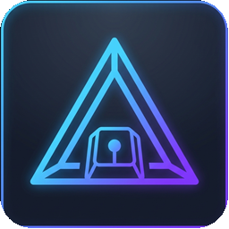
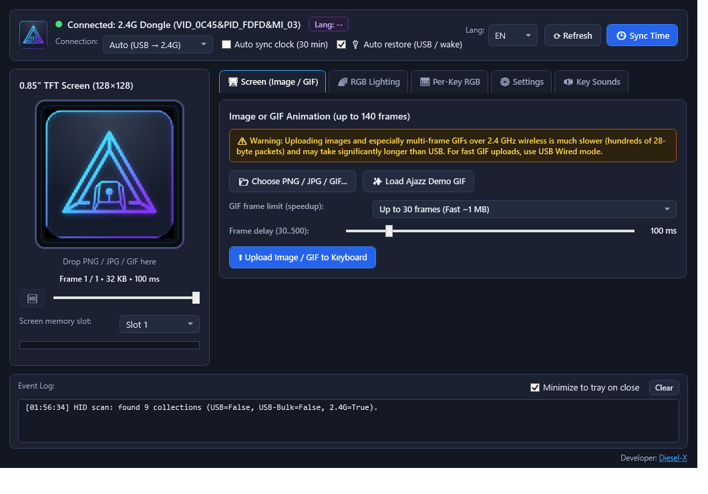
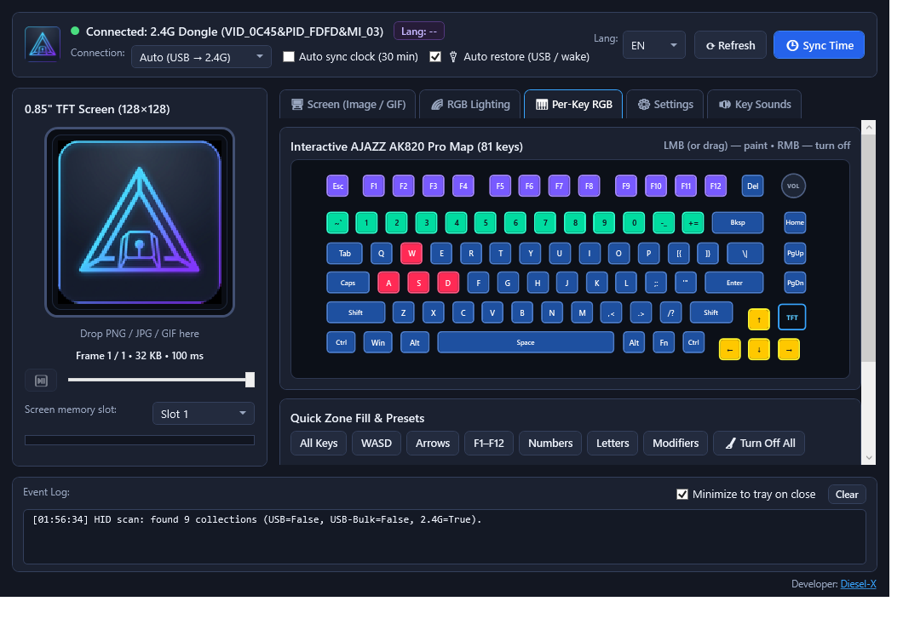
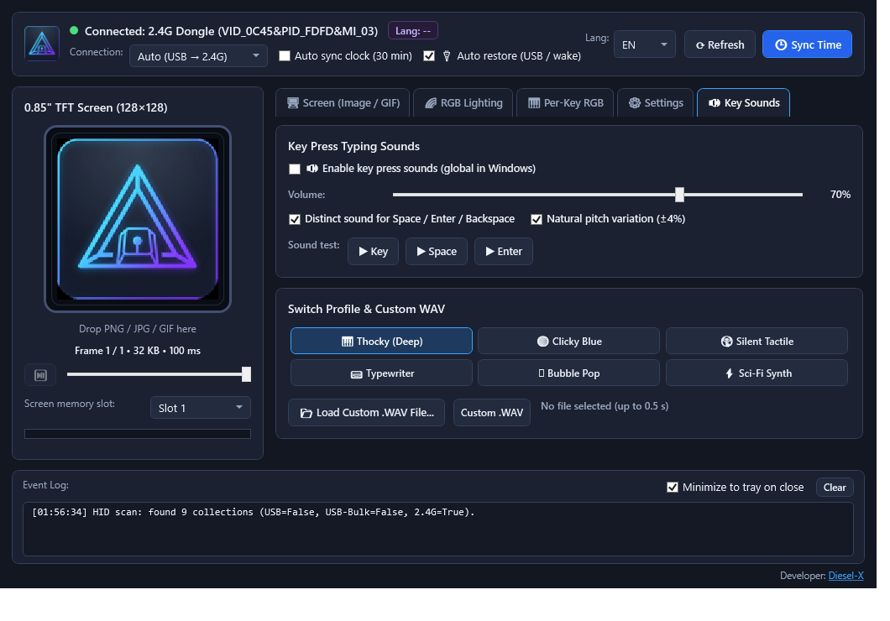

<div align="center">



# AjazzCtl

**Open-source Windows utility and CLI for AJAZZ AK820 Pro (Tri-Mode 0.85" TFT — CN & Global)**

**English** | [Русский](README.ru.md)

[](https://github.com/Diesel-x/AjazzCtl/actions/workflows/build.yml)
[](https://github.com/Diesel-x/AjazzCtl/releases/latest)
[](LICENSE)

</div>

AjazzCtl is a clean, lightweight replacement for the official AJAZZ AK820 Pro desktop software (`DeviceDriver.exe`). It communicates directly with the keyboard over Windows HID (`hid.dll` / `setupapi.dll` / `kernel32.dll`) in both **USB Wired** and **2.4 GHz Wireless Dongle** modes, with zero third-party dependencies and no extra USB drivers required.

---

## Download

Get the latest binaries from the **[Releases page](https://github.com/Diesel-x/AjazzCtl/releases/latest)**:

* **`AjazzCtl-v1.0.0-win-x64-standalone.exe`** — Portable single-file executable with .NET 8 bundled in. Download and run anywhere.
* **`AjazzCtl-v1.0.0-win-x64-net8.zip`** — Lightweight build if you already have [.NET 8 Desktop Runtime (x64)](https://dotnet.microsoft.com/en-us/download/dotnet/8.0) installed.

> **Requirements:** Windows 10 / 11 (x64). No Zadig, WinUSB, libusb, or OEM drivers needed — uses built-in Windows `hidusb.sys`.

---

## Screenshots

**Screen Upload (0.85" TFT 128×128)**  


**Interactive 81-Key Per-Key RGB Editor**  


**Key Press Sound Synthesizer**  


---

## AjazzCtl vs Official AJAZZ Driver

| Feature | AjazzCtl | Official Driver (`DeviceDriver.exe`) |
| :--- | :--- | :--- |
| **Source Code & Privacy** | Open-source (MIT) + full [PROTOCOL.md](PROTOCOL.md) | Closed-source OEM binary |
| **Installation & Footprint** | Single portable `.exe` + built-in Full Uninstall | Windows installer in `Program Files (x86)` with MFC/MSVC DLLs |
| **2.4 GHz Screen Upload** | Enabled over 2.4 GHz dongle (`MI_03`) as well as USB | Hidden/disabled in 2.4G UI (`screen="0"`) |
| **GIF Optimization** | Automatic frame subsampling (`30 / 60 / 140`) with delay scaling | Raw frames without automatic subsampling |
| **Flash Protection** | `250 ms` slider debounce on instant RGB changes | Sends immediate writes on UI change |
| **CLI & Scripting** | Full CLI (`status`, `sync-time`, `light`, `per-key`, `settings`, `screen-image`, `--dry-run`) | GUI only |
| **Windows Integrations** | USB/wake auto-restore (`WM_DEVICECHANGE`), `RU/EN` layout indicator, typing sound synth (`.wav` + 6 presets) | Not included |
| **Key Remap & Macros** | Not implemented yet | Supported |

---

## Features

### 0.85" TFT Screen Upload (PNG / JPG / BMP / GIF)
* Converts images and animated GIFs to `128×128 RGB565` little-endian format and writes them to any of the keyboard's 10 screen slots (`Slot 1..10`).
* Drag-and-drop preview inside a 0.85" screen bezel, playback scrubber, frame delay adjustment (`30..500 ms`), and frame subsampling (`30 / 60 / up to 140 frames`) that scales delays to preserve animation timing.
* Works over **USB Wired** (4097-byte bulk pipe `MI_02`) and **2.4 GHz Wireless** (28-byte chunked protocol over `MI_03`).
* *Note:* Over 2.4 GHz wireless, frames are sent in 28-byte reports and take significantly longer than USB; USB is recommended for multi-frame GIFs.

### RGB Backlight & Per-Key Color Editor
* All 20 hardware lighting effects (`0..19`), RGB color picker/presets, brightness (`0..5`), speed (`0..5`), direction, and rainbow mode.
* Built-in `250 ms` slider debounce on live apply to avoid hammering keyboard flash cells while dragging controls.
* Interactive **81-key AK820 Pro layout editor**: click or drag with left mouse button to paint keys, right-click to turn individual LEDs off, fill zones (`WASD`, arrows, F-row, numbers, letters, modifiers), or load color themes (`Cyberpunk`, `Gamer`, `Sunset`, `Rainbow`).

### Keyboard Settings & Clock Sync
* Direct PC clock synchronization (`Sync Time`) and optional periodic sync (`30 min`).
* Hardware debounce level (`1..5`), 2.4 GHz sleep timer (`Off`, `1 min`, `5 min`, `30 min`), Win-lock, Alt+F4 lock, Alt+Tab lock, and Fn layer invert.

### Optional Background Utilities
Settings live inside the keyboard's flash memory, so you can configure the keyboard once and exit completely—or keep AjazzCtl minimized in the system tray for OS-driven features:
* **USB / Wake Auto-Restore:** Listens for `WM_DEVICECHANGE` and Windows power resume events to re-sync time and reapply your last lighting setup.
* **Input Layout Indicator (RU / EN):** Watches the active Windows input language and colors either the whole board or just `Caps Lock` + `Space` + `Esc` on switch.
* **Typing Sound Simulator:** Low-latency polyphonic WinMM `waveOut` audio engine with 6 synthesized profiles (`Thocky`, `Clicky Blue`, `Silent Tactile`, `Typewriter`, `Bubble Pop`, `Sci-Fi`), custom `.WAV` support, and distinct `Space` / `Enter` / `Backspace` tones.

### Multilingual & Clean Uninstall
* Interface available in **English**, **Russian**, **Chinese**, and **German** (automatically matches your Windows UI language, falling back to English).
* Launches cleanly as a native Windows GUI (`WinExe`) with no flashing console window.
* Includes a **Full Uninstall** button in Settings to clean startup registry entries, `%LocalAppData%\AjazzCtl` / `%AppData%\AjazzCtl`, and remove the executable.

---

## CLI Usage

AjazzCtl also supports headless commands from PowerShell or Command Prompt:

```powershell
AjazzCtl.exe status
AjazzCtl.exe sync-time --mode usb --slot 1
AjazzCtl.exe light --mode 1 --color #38A5FF --brightness 5 --conn usb
AjazzCtl.exe per-key --preset gamer --brightness 5 --conn usb
AjazzCtl.exe settings --debounce 1 --sleep 2 --win-lock 1 --conn usb
AjazzCtl.exe screen-image animation.gif --slot 1 --conn usb
AjazzCtl.exe test
```

Add `--dry-run` to inspect generated 64-byte USB Feature and 33-byte 2.4G HID packets without writing to the keyboard.

---

## FAQ

**Do I need to install the official AJAZZ driver or custom USB drivers?**  
No. Windows binds `hidusb.sys` automatically. AjazzCtl talks straight to the standard HID collections exposed by the keyboard (`VID_0C45&PID_8009`/`800A` over USB, `PID_FDFD` over 2.4G).

**Why isn't Bluetooth configuration supported?**  
In Bluetooth mode, the AK820 Pro firmware exposes standard HID input/battery profiles only and disables the vendor configuration HID interfaces (`UsagePage 0xFF13 / 0xFF60 / 0xFF68`). Everything saved to keyboard memory over USB or 2.4G (screen slots, RGB profiles, debounce, clock) continues working over Bluetooth, and AjazzCtl's typing sound engine also works in Bluetooth mode.

**Why does uploading 1 image take ~1.5–2 seconds over USB?**  
Command `0x04 0x72` writes each 4 KB block to external SPI NOR flash inside the keyboard (sector erase + write + screen progress bar update) before returning a 65-byte ready report. The keyboard hardware dictates that pace; sending chunks without waiting causes the keyboard to drop frames at 99%.

**Where is the HID protocol documented?**  
Full reverse-engineered packet layouts and frame formats are documented in **[PROTOCOL.md](PROTOCOL.md)**.

---

## Build from Source

Requires [.NET 8 SDK](https://dotnet.microsoft.com/en-us/download/dotnet/8.0) on Windows:

```powershell
git clone https://github.com/Diesel-x/AjazzCtl.git
cd AjazzCtl
dotnet build AjazzCtl.csproj -c Release
dotnet run --project AjazzCtl.csproj -c Release --no-build -- test
```

Publish a portable single-file build:

```powershell
dotnet publish AjazzCtl.csproj -c Release -r win-x64 --self-contained true -p:PublishSingleFile=true -p:IncludeNativeLibrariesForSelfExtract=true -o publish
```

---

## License & Disclaimer

Released under the [MIT License](LICENSE).  
Independent community project by [Diesel-x](https://github.com/Diesel-x). Not affiliated with, endorsed by, or containing any proprietary binaries from AJAZZ.
