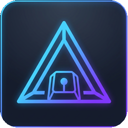
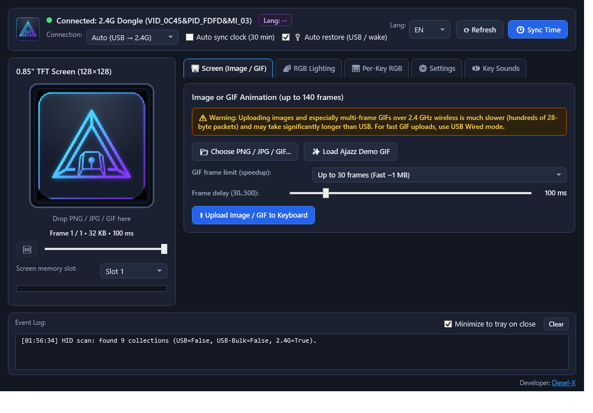
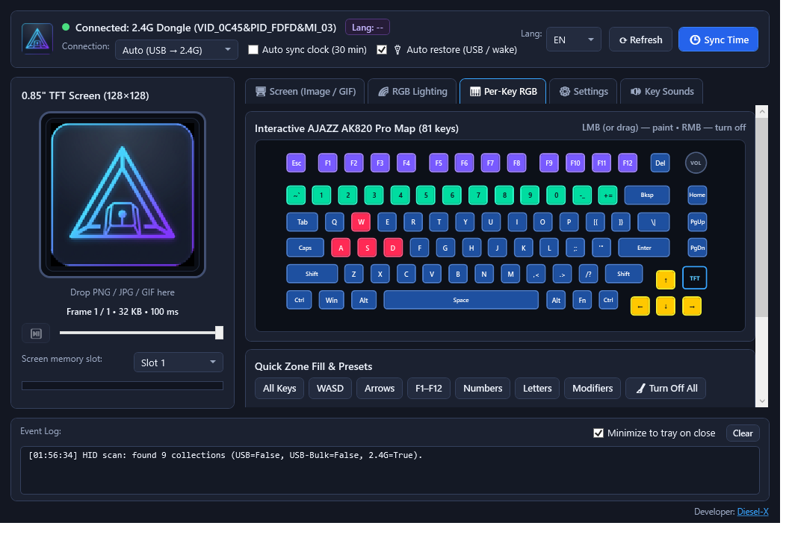
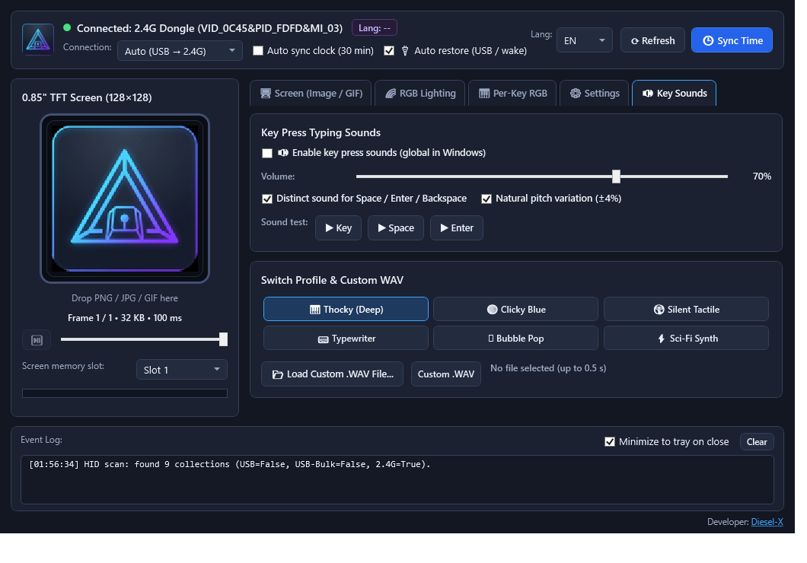

<div align="center">



# AjazzCtl

**Лёгкая open-source утилита и CLI для клавиатуры AJAZZ AK820 Pro (Tri-Mode 0.85" TFT — CN и Global версии)**

[English](README.md) | **Русский**

[](https://github.com/Diesel-x/AjazzCtl/actions/workflows/build.yml)
[](https://github.com/Diesel-x/AjazzCtl/releases/latest)
[](LICENSE)

</div>

AjazzCtl — компактная альтернатива официальному китайскому драйверу `DeviceDriver.exe` для клавиатуры **AJAZZ AK820 Pro** (Tri-Mode, 0.85" TFT-экран). Программа работает напрямую через стандартный HID-стек Windows (`hid.dll` / `setupapi.dll` / `kernel32.dll`) по **USB** и через **ресивер 2.4 ГГц** без установки сторонних драйверов и библиотек.

---

## Скачать

Готовые сборки доступны на странице **[Releases](https://github.com/Diesel-x/AjazzCtl/releases/latest)**:

* **`AjazzCtl-v1.0.0-win-x64-standalone.exe`** — полностью автономный портативный `.exe` со встроенным .NET 8 Runtime. Скачал и запустил на любой чистой Windows 10/11.
* **`AjazzCtl-v1.0.0-win-x64-net8.zip`** — облегчённая сборка, если на ПК уже установлен [.NET 8 Desktop Runtime (x64)](https://dotnet.microsoft.com/en-us/download/dotnet/8.0).

> **Требования:** Windows 10 / 11 (x64). Никакие Zadig, WinUSB, libusb или официальный софт от AJAZZ не требуются — используется штатный системный драйвер `hidusb.sys`.

---

## Скриншоты

**Загрузка картинок и GIF на 0.85" TFT-экран**  


**Интерактивный редактор поклавишной RGB (81 клавиша)**  


**Звуки нажатия клавиш**  


---

## Основные возможности

### Загрузка картинок и GIF на 0.85" TFT-экран
* Конвертация PNG / JPG / BMP / GIF в формат клавиатуры `128×128 RGB565` (Little-Endian) и запись в любой из 10 слотов памяти экрана (`Слот 1..10`).
* Предпросмотр в рамке экранчика (поддерживается Drag & Drop), покадровая прокрутка, настройка задержки кадров (`30..500 мс`) и оптимизация длинных GIF (лимит `30 / 60 / до 140` кадров с пропорциональным сохранением длительности анимации).
* Работает по **USB** (быстрый 4097-байтовый канал `MI_02`) и по **2.4 ГГц** (пакеты по 28 байт через `MI_03`).
* *Важно:* по каналу `2.4 ГГц` данные передаются маленькими пакетами, поэтому загрузка картинок и особенно многокадровых GIF заметно дольше, чем по проводу — для GIF лучше подключать USB-кабель.

### RGB-подсветка и поклавишный редактор
* Все 20 встроенных эффектов (`0..19`), палитра, ползунки RGB, яркость (`0..5`), скорость (`0..5`), направление эффекта и радужный режим.
* Встроенный debounce ползунков (`250 мс`) при мгновенном применении, чтобы не изнашивать флеш-память контроллера при перетаскивании.
* Интерактивная **карта на 81 клавишу AK820 Pro**: рисование мышью (ЛКМ — покрасить, ПКМ — выключить светодиод клавиши), заливка зон (`WASD`, стрелки, `F1–F12`, цифры, буквы, модификаторы) и готовые темы.

### Системные настройки и синхронизация часов
* Синхронизация встроенных часов клавиатуры с временем ПК (`0x04 0x28`), опциональная автосинхронизация раз в 30 минут.
* Настройка отклика клавиш (`Debounce 1..5`), таймера сна для 2.4 ГГц (`выкл`, `1`, `5`, `30 мин`), блокировка `Win`, `Alt+F4`, `Alt+Tab` и инверсия слоя `Fn`.

### Дополнительные фоновые функции (по желанию)
Настройки сохраняются в память самой клавиатуры, поэтому программу можно закрыть сразу после настройки — либо оставить в системном трее для работы с событиями Windows:
* **Автовосстановление (USB / выход из сна):** отслеживает `WM_DEVICECHANGE` и пробуждение ПК, автоматически обновляя время и возвращая выбранную подсветку.
* **Индикация раскладки (RU / EN):** меняет цвет всей подсветки или зоны `Caps Lock + Space + Esc` при переключении языка ввода в Windows.
* **Звуки нажатия клавиш:** встроенный полифонический аудиодвижок на `winmm.dll waveOut` + глобальный перехват клавиш (без повторов при зажатии). Доступно 6 синтезированных профилей (`Thocky`, `Clicky Blue`, `Silent Tactile`, `Печатная машинка`, `Пузырьки`, `Sci-Fi`), загрузка собственного `.WAV` и отдельные звуки для `Space / Enter / Backspace`.

### Языки и чистое удаление
* Интерфейс на **Русском**, **English**, **中文** и **Deutsch** (при первом запуске выбирается язык Windows, иначе английский).
* Приложение собрано как `WinExe` — при запуске GUI консоль не появляется и не мелькает.
* Вкладка настроек содержит кнопку **Полная деинсталляция**, которая удаляет записи автозапуска, локальные папки кэша (`%LocalAppData%\AjazzCtl`, `%AppData%\AjazzCtl`) и файлы программы.

---

## Работа из командной строки (CLI)

Все функции также доступны из PowerShell или CMD:

```powershell
AjazzCtl.exe status
AjazzCtl.exe sync-time --mode usb --slot 1
AjazzCtl.exe light --mode 1 --color #38A5FF --brightness 5 --conn usb
AjazzCtl.exe per-key --preset gamer --brightness 5 --conn usb
AjazzCtl.exe settings --debounce 1 --sleep 2 --win-lock 1 --conn usb
AjazzCtl.exe screen-image animation.gif --slot 1 --conn usb
AjazzCtl.exe test
```

Флаг `--dry-run` выводит собранные HID-пакеты (64 байта для USB Feature или 33 байта для 2.4G) без отправки на устройство.

---

## Частые вопросы

**Нужно ли устанавливать родной драйвер AJAZZ или Zadig?**  
Нет. Windows автоматически подключает устройство через стандартный системный драйвер `hidusb.sys`.

**Почему нет настройки через Bluetooth?**  
Это ограничение самой прошивки клавиатуры: в режиме Bluetooth открываются только стандартные HID-профили ввода и батареи, а вендорские интерфейсы настройки (`UsagePage 0xFF13 / 0xFF60 / 0xFF68`) не активны. Всё, что записано в память клавиатуры по USB или 2.4 ГГц, продолжает работать и на Bluetooth; звуки клавиш в Windows тоже работают при любом подключении.

**Почему 1 картинка грузится около 1.5–2 секунд по USB?**  
Команда `0x04 0x72` записывает блоки по 4 КБ во внешнюю микросхему SPI Flash клавиатуры, стирая сектора и перерисовывая прогресс на TFT-экране. Программа ждёт 65-байтовый сигнал готовности от контроллера после каждого блока, иначе при потоковой отправке без ожидания кадры теряются.

**Где посмотреть описание HID-протокола?**  
Полная спецификация пакетов вынесена в файл **[PROTOCOL.md](PROTOCOL.md)**.

---

## Сборка из исходников

Потребуется [.NET 8 SDK](https://dotnet.microsoft.com/en-us/download/dotnet/8.0) под Windows:

```powershell
git clone https://github.com/Diesel-x/AjazzCtl.git
cd AjazzCtl
dotnet build AjazzCtl.csproj -c Release
dotnet run --project AjazzCtl.csproj -c Release --no-build -- test
```

Сборка автономного одиночного `.exe`:

```powershell
dotnet publish AjazzCtl.csproj -c Release -r win-x64 --self-contained true -p:PublishSingleFile=true -p:IncludeNativeLibrariesForSelfExtract=true -o publish
```

---

## Лицензия

Проект распространяется под лицензией [MIT](LICENSE).  
Независимая open-source разработка ([Diesel-x](https://github.com/Diesel-x)). Не связано с брендом AJAZZ и не содержит проприетарных файлов от производителя.
